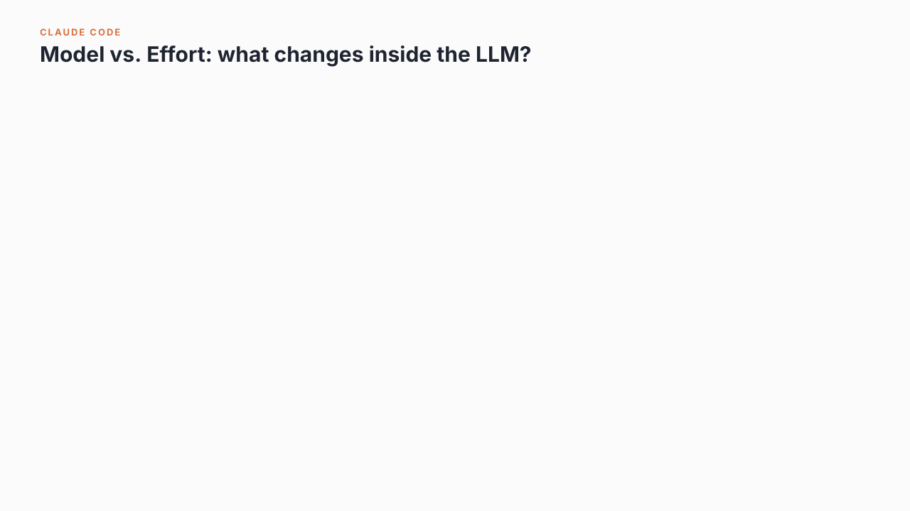

# 10 · Model vs. Effort（模型与努力程度）

这个主题有三页。





> **一句话**：`/model` 决定生成每个 token 要花多少计算，`/effort` 决定一共生成多少个 token。总成本和耗时大致是两者的乘积。

## 在演讲里的位置

最后一章，回到实际使用。标题问的是 "what changes inside the LLM?"（模型内部变了什么）。答案要用 03 的生成循环来解释：一个旋钮改变循环**每一步的代价**，另一个改变循环**跑多少步**。这三页是对 03 的直接应用，讲的时候要把那个循环再提一次。

## 第一页：/model（10a，10.7 s）

| 时间 | 画面 | 这时候讲什么 |
|---|---|---|
| 0–2.5 s | 三个框：Haiku（网络最小）、Sonnet（中等）、Opus（最大） | "三个模型，区别是网络的大小" |
| 2.5–9 s | 信号在三个网络里同时从左向右流动，下方的 token 计数各自增长 | "同样的时间里，小网络跑完的次数多" |
| 约 8 s | `Same generation loop, different weights.` 和公式 | "循环是同一个，换的是权重" |
| 结束时 | 计数：Haiku 17、Sonnet 9、Opus 5 | "网络越大，同样时间里生成的 token 越少" |

三个框的标签：

| 模型 | 标签 | 结束时的 token 数 |
|---|---|---|
| Haiku | fastest · cheapest | 17 |
| Sonnet | balanced | 9 |
| Opus | most capable | 5 |

字幕：*"Model = which weights compute each step of the generation loop"*，然后是 *"Bigger model: more compute per token, so fewer tokens per second"*。

### 画面上的公式

```
compute per token ≈ 2 × number of parameters (FLOPs)
```

意思是：生成一个 token 所需的计算量，大约是参数个数的两倍（以浮点运算次数计）。这是一个粗略的经验估算，要传达的只有一点：**每个 token 的计算量和模型大小成正比**。参数多一倍，每个 token 大约贵一倍、慢一倍。

公式下方的小字：*bigger network → more knowledge & reasoning per step, but slower and pricier per token · sizes not published*。最后半句值得说出来：各家都不公布模型的具体参数量，图里的网络大小只是示意。

### 关于 "Opus · most capable" 的标签

这个标签需要你自己决定怎么处理。按目前的 Claude 产品线，Opus 之上还有 Fable，Opus 已经不是能力最强的那一个。画面没有改。可选的处理方式：

- 讲的时候口头补一句："图里画了三个作代表，实际产品线里还有更强的型号，道理一样：越大越强，也越慢越贵。"
- 或者之后把画面上的标签改掉。

无论哪种，这一页要传达的规律（大小、能力、速度、价格之间的关系）不受影响。

## 第二页：/effort（10b，10.6 s）

| 时间 | 画面 | 这时候讲什么 |
|---|---|---|
| 0–2 s | 标题 `Same model · same task · different effort level`，五行：low、medium、high、xhigh、max | "现在模型不变，任务不变，只改 effort" |
| 2–8 s | 每一行的条从左向右生长，由紫、橙、绿三种色块组成 | "条越长，生成的 token 越多" |
| 逐行完成 | 右侧依次出现 ≈1×、≈2×、≈3×、≈4×、≈5× | "low 最先完成，max 最后" |
| 约 8 s | `Effort scales ALL output tokens: thinking, tool calls and text. Low = fewer, terser tool calls.` | "三种 token 都跟着变" |

三种色块：

| 颜色 | 含义 |
|---|---|
| 紫色 | thinking（思考过程） |
| 橙色 | tool calls (+ results)（工具调用及其结果） |
| 绿色 | answer text（最终回答） |

仔细看每一行的结构：low 只有一段思考、一次工具调用就给出答案；max 是思考和工具调用交替很多轮之后才给出答案。也就是说，effort 高不只是"想得久"，也意味着**多做几轮 Agent 循环**（04）。

字幕：*"Effort = how much work the same model puts into one request"*，然后是 *"Higher effort → more thinking & tool calls → slower, costlier, more thorough"*。

右下角的小字 **(illustrative)** 要说出来：≈1× 到 ≈5× 是示意，不是实测比例。实际倍数取决于任务。

## 第三页：两个旋钮相乘（10c，5.7 s）

| 时间 | 画面 | 这时候讲什么 |
|---|---|---|
| 0–2 s | `Total cost & latency ≈ output tokens × compute per token` | "把前两页合起来" |
| 2–3.5 s | 两个框下方的标注 | "一个由 /effort 定，一个由 /model 定" |
| 3.5–5 s | 灰色框里的两条建议 | 给出选择建议 |
| 最后 | 底部小字：输入 token 的说明 | 补一句 |

公式和标注：

```
Total cost & latency  ≈  output tokens   ×   compute per token
                         set by /effort      set by /model
                         how many loop       cost of each
                         iterations          iteration
```

这里的 "loop iterations" 指的就是 03 的生成循环：每生成一个 token 是一次迭代。

灰色框里的两条建议：

| 任务类型 | 建议 |
|---|---|
| Hard, ambiguous, multi-step task（困难、模糊、多步骤） | stronger model and/or higher effort |
| Small, well-defined edit（小的、明确的修改） | smaller model, lower effort: fast & cheap |

底部小字：*"Plus input tokens: in an agent loop the growing context is re-read at every step (prompt caching makes this cheaper)."* 意思是除了输出，还有输入的成本：Agent 每一轮都要重新读入不断变长的上下文（04、09），提示缓存能降低这部分费用。

字幕：*"Two independent knobs, multiplied together"*

## 需要真正搞懂的概念

### 用 03 的循环来理解这两个旋钮

回忆生成循环：每一圈做一次前向传播，产出一个 token。

- **换模型** = 换一套权重。每一圈的计算量变了，圈数不一定变。
- **调 effort** = 权重不变。模型被引导去多想、多查、多验证，于是圈数变多了。

所以这一页的标题问 "what changes inside the LLM?"，答案是：`/model` 改变的是模型内部（权重），`/effort` 其实不改变模型内部的任何东西，改变的是它产出多少。

### "思考"也是输出 token

03 提到过：思考过程是用同一个循环生成出来的文字，只是不作为最终答案展示。所以思考同样花时间、同样计费。高 effort 之所以更贵，很大一部分是因为紫色的那部分变多了。

### 模型大小带来什么

- **更大**：每一步"看得更深"，知识更多，推理能力更强，更擅长处理模糊和需要多步推导的问题。
- **代价**：每个 token 更贵，生成更慢。

模型的能力上限是由权重决定的。effort 调得再高，也只是让同一个模型更认真地做，不会让它变成另一个模型。

### 两个旋钮怎么搭配

可以把它们想成两个不同的问题：

- **`/model`**：这个任务需要多聪明的"人"来做？
- **`/effort`**：这个"人"需要多仔细地做？

一些实用的判断：

| 情况 | 倾向 |
|---|---|
| 改个变量名、补一行日志 | 小模型、低 effort |
| 按明确的规格实现一个函数 | 中等模型、中等 effort |
| 排查原因不明的 bug | 更强的模型 |
| 改动涉及很多文件，需要反复验证 | 更高的 effort |
| 需求本身就没说清楚 | 更强的模型，并先让它提问 |

### "independent"（独立）的含义

两个设置可以分别调，互不限制，这是"独立"的意思。但它们对结果的影响并非完全无关：更强的模型有时用更少的步骤就能做对，所以实际的 token 数量也会随模型变化。公式里用的是 "≈"，表达的是量级关系，不是精确等式。

### 成本的另一半：输入 token

公式只写了输出。Agent 场景里输入往往占大头，原因是 04 讲的：每一轮都要把全部上下文重新读入。10 轮的任务，最初那段系统提示被读了 10 次。这就是 09 那些控制上下文的办法在成本上的意义。提示缓存（prompt caching）让重复读入的前缀部分便宜很多。

## 常见误解

- **"effort 越高答案越好"**：对简单任务没有帮助，只是更慢更贵。
- **"大模型在所有事情上都更合适"**：小任务上小模型又快又便宜，质量没有差别。
- **"effort 调的是模型的聪明程度"**：不是。聪明程度由权重决定，effort 调的是工作量。
- **"切换模型会丢失对话"**：不会。上下文在 harness 手里（04），换模型只是换了下一轮由谁来读它。

## 听众可能会问

**Q：默认应该用什么？**
从默认设置开始。结果不够好时，先判断问题出在"不够聪明"还是"不够仔细"，再决定调哪个。

**Q：每个 token 的价格差多少？**
不同档位的模型单价不同，输出比输入贵。具体数字会调整，以官方价格页为准，演讲里不建议报具体数字。

**Q：图里的神经网络就是真实结构吗？**
不是。图里画的是简单的全连接网络，只是为了表示"大小不同"。真实结构是 03 里那种 Transformer 层的堆叠。

**Q：五档 effort 的差别真的是 1 到 5 倍吗？**
不是，倍数是示意。实际差别取决于任务，简单任务上各档可能很接近。

## 承上启下与收尾

这是最后一个主题。讲完 10c，可以用开头的三句话收尾，呼应整场演讲：

1. 模型看到的只有 **token**。
2. 模型做的只有 **预测下一个 token，然后循环**。
3. 我们能做的两件事：管理**什么进入上下文**（Agent、工具、RAG、MCP、Skills、上下文工程），以及决定**这个循环跑多贵、跑多久**（model 和 effort）。

## 自测

<details>
<summary>1. 用 03 的生成循环解释 /model 和 /effort 分别改变了什么。</summary>

`/model` 换权重，改变循环每一圈的计算量。`/effort` 不换权重，改变循环跑多少圈（生成多少 token）。
</details>

<details>
<summary>2. 高 effort 多出来的 token 是哪三类？</summary>

思考、工具调用（及其结果）、回答文本。三类都会增加。
</details>

<details>
<summary>3. 为什么 Agent 任务里输入 token 的成本不能忽略？</summary>

每一轮都要把不断变长的全部上下文重新读入，轮数越多，累计的输入量越大。
</details>
